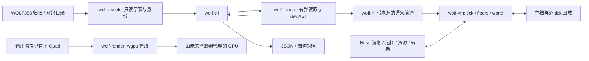

# wolf-rs 架构与验证边界

## 1. 目标和证据

默认目标是 Windows / Linux / macOS 桌面；Wasm、移动端、编辑器和原版存档兼容不属于首阶段。实现从 [本地数据规范](../../docs/data_formats_spec.md) 出发，以原始语法保真为先决条件。原生循环只有有限静态证据；下述模拟时序是新运行时设计，尚未通过原游戏轨迹验证。

当前已有格式检查、WOLF350 归档解码及实验性无窗口 VM；渲染库可编译及验证 WGSL，但未接通真实地图视觉语义或 GPU 呈现。IR 的局部控制流校验和 VM 的确定性服务/调度机制可运行，游戏 opcode 语义仍只有待验证子集，不宣称完整兼容。

## 2. 实际依赖与所有权



| 模块 | 现在的责任 | 后续责任/依赖约束 |
| --- | --- | --- |
| `wolf-assets` | 显式 loose mount 与受限 WOLF350 v1 归档 reader、路径验证、内容身份 | 其他 archive profile、挂载覆盖、加载合并、CPU 缓存；不依赖 wgpu |
| `wolf-format` | bytes → 原始 `Map/CommonEvents` 与重建流；不推断游戏行为 | 追加数据库、TileSetData、MapTree、Game 配置；不访问文件/窗口/GPU |
| `wolf-cli` | 装配资产/格式/IR/VM、指令覆盖与 trace、可选 Host 输入脚本 | 可玩入口、设备后端与场景适配 |
| `wolf-render` | `Camera/TileInstance` → pipeline、纹理数组、buffer、draw | 不可变 snapshot、复用缓冲、上传、裁剪、文本与效果；不修改世界 |
| `wolf-ir` | 保守 opcode lowering、来源信息、分支/循环/调用结构校验、unsupported 列表 | 与原版校准参数及全部事件结构；编译成功不等于原版兼容 |
| `wolf-vm` | 确定性 tick、多 fiber、调用栈、变量、等待 token、预算、存档/恢复、回放、Host；显式场景规则 | 原生页面/路线适配、未支持 opcode、原版调度/RNG/文本校准 |
| `wolf-media` | 独立的 RGBA 图片合成与 PCM 混音 | 图像/音频 codec、设备后端、原生 opcode/效果适配 |
| `wolf-platform/player`（计划） | — | 窗口、输入、音频、存储、设备生命周期及模块装配 |

第一阶段同步加载、单线程模拟。以后资产 worker 只发送不可变结果；通道有界，模拟在规定 tick 才接受完成结果；渲染单独拥有 GPU 对象。不得依据线程完成顺序或 HashMap 遍历顺序执行事件。

## 3. 资产和格式层

当前 `LooseMount` 的根必须由调用者显式指定。路径规范化仅统一分隔符，拒绝绝对路径、设备名、遍历、空组件、尾随空格/点、控制字符。逐组件检查实际名称以维持跨平台精确查找，拒绝链接和 Windows reparse point；`list` 拒绝 NFC + 小写转换的键碰撞并排序。此保守策略尚未证明等同 WOLF 的名称查找规则；也不是面对并发恶意文件替换的安全隔离系统。

`AssetId` 保留 mount、original_path、规范键、存储内容 BLAKE3、decoder profile。重建流另存 BLAKE3，验证报告用 SHA-256 对接原证据。归档目录 CP932 与成员文本 UTF-8 分别处理；Archive 保留原始 CP932 名字节，loose mount 使用系统返回的 Unicode 名称。BasicData 的 62 B 前缀在格式适配边界处理，归档 API 保留成员字节。

归档流程为：profile 判定 → 校验索引/偏移 → WOLF350 专属解密与归档压缩 → 成员身份 → 格式自己的 LZ4 → AST。不能凭 DXA v8 魔数套通用 codec。当前仅支持本地 corpus 的 flags=0x015e0000，并逐成员验证 12 包；其它 flags 和小型归档明确拒绝。挂载优先级应由配置中的 `(priority, mount_id)` 显式指定。

未来缓存按 `(source_digest, path, decoder_profile)` 合并请求；CPU 与 GPU 预算分离。状态为 `Absent/Loading/Ready/Failed`，每个引用带代数。VM 等待请求 token，资产完成在确定的 tick 边界转为可见；回放记录可见时刻。设备恢复时根据 CPU 描述或来源身份重建 GPU 缓存。

`wolf-format::Limits` 默认限制：存储/重建各 128 MiB、AST 256 MiB、单字符串 4 MiB、单计数字段 1,000,000、tile word 16,000,000。分配前检查乘加、剩余字节与预算；LZ4 在每次输出前检查预期长度，并支持重叠回引。计费是 AST 请求容量与字节数，不承诺整个进程 RSS 上限；`--details` 会保留全 corpus AST，生产流式导入需另设总预算。

错误携带 `Stored/Reconstructed` 偏移域。AST span 使用保留前缀的重建域；未压缩 v100 两域数值相同。`RawCommand` 保留 opcode、i32 参数、缩进、含 NUL 的字符串原始字节、终止符、移动路线、扩展长度与扩展。文件身份和 event/page/index 从上层上下文绑定；重建流保留完整原始标记。

## 4. IR 与确定性事件 VM（已实现与缺口）

IR 每条操作携带 `(asset identity, profile, event id, page, command index, span)` 和完整 RawCommand。编译器使用显式数字匹配，不以 Rust enum 顺序表示外部 opcode。主事件与 route 保持不同空间。当前 profile 为 `wolf350-evidence-subset-v2`，映射与原生静态证据见 [vm.md](vm.md)。

编译阶段从已证实的指令 schema 建立分支、标签、循环、调用目标，校验跳转和栈深度；缩进只作证据，不能单独构成控制流算法。参数按 opcode 区分立即数、变量、间接引用和 flags；整数溢出、除法/余数、RNG 与字符串行为由版本 profile 指定，不套用 Rust 默认值。

模拟拥有 `WorldState` 和按稳定 ID 排序的 fibers。每个 fiber 保存调用栈、PC、局部上下文、页代数及 typed wait：tick/message/choice/movement/asset/transition。服务 token 为 `(session_generation, sequence)`；sequence 单调递增并检查溢出。发出请求后推进 PC，再保存等待；完成消息须匹配当前 token。读档/换页/取消后的旧完成通知不得唤醒新等待。

按显式事件调度策略分配**全局每 tick 指令预算**，避免“每个 fiber 各有一大份预算”导致总量失控。预算用尽合作让出；连续耗尽报告 hot-loop。可达未知 opcode 暂停对应执行并报告来源，不作为 NOP；分析模式仍可枚举后续 raw records。自动/并行事件、前台互斥、公共事件调用与换页时机必须由原作轨迹校正。

逻辑时钟暂定 60 Hz，明确属于设计参数。使用整数累加 `accumulator += elapsed_ns * hz`，每消耗 `1_000_000_000` 产生一个 tick，保留余数；checked arithmetic 防溢出。每次窗口回调限制追赶 tick 数，积压保留并显式报告；不能静默丢弃逻辑时间。

```text
接收带序号的输入 → tick 边界接受服务完成
→ 更新 typed waits → 页条件/触发器（可替换规则）
→ 稳定调度并在全局预算内执行 fibers
→ 世界命令、移动/碰撞与场景屏障
→ 生成只读 RenderSnapshot → 可独立频率呈现
```

VM 存档 v2 已保存库身份、tick、RNG、各变量空间、fiber/页代数、栈/PC/循环、预约调用、等待和请求；恢复校验状态与库一致并重绑定会话 token。v1 未区分持久 commonself，不作隐式迁移。Host 保存转场截止 tick 和未消费回复，须与 VM 成对恢复。回放 v2 校验初始及每 tick 状态哈希，输入包含 global/system 写入与完成通知；暂不记录中途 spawn/cancel/换页。场景/移动与媒体状态还未纳入这套存档。原版 `.sav` 支持另设证据与验收门槛。

## 5. 渲染契约

锁定 wgpu/naga 30.0.1。`TileInstance` 为 56 B，字段偏移依次为 0/8/16/24/32/48/52；`Camera` 为 16 B。group 0 是 camera uniform；group 1 是 D2Array + sampler。每实例由 `vertex_index` 生成六顶点；纹理数组层表示 atlas page，不表示地图层。

导入图片为 straight RGBA sRGB，纹理 `Rgba8UnormSrgb`，nearest、无 mip；tint 为线性颜色。shader 采样并乘 tint 后预乘 alpha，配合 `PREMULTIPLIED_ALPHA_BLENDING`。左上像素原点转 NDC；flip flags 是新渲染 IR 字段，不能解释为原始 tile 位域。原作混合空间与透明效果仍需同帧截图验证。

当前调用者负责非零 atlas 尺寸、设备 limits、实例容量/页范围、非零 camera viewport 和排序；API 仍是低层管线库。创建实例 buffer 每次分配，未实现常驻 buffer 或上传图像；不能称为完成的 Tilemap Renderer。未来 `TileResolver(raw_word, tileset, tick)` 决定自动元件与 quad；碰撞单独解析。未证实 tile ID 不能直接换算 UV。

排序键保留 pass、priority、foot_y、stable id；只合并连续且兼容的透明图元。视口裁剪与 dirty chunks 再按实际性能引入；32×32 仅候选性能参数。图集超设备容量时拆成保持顺序的 draw segments。字体、图片效果、转场和加/减色单独建立规则。

平台入口依次创建 Instance/Surface、兼容 Adapter、按 capabilities 选择 features/limits、Device/Queue、Surface config。优先支持的 sRGB/FIFO；零窗口尺寸跳过 acquire/configure；resize、suspend/resume、surface error/device loss 由播放器恢复，保留模拟状态。离屏逻辑分辨率 + nearest letterbox 与指针输入使用同一逆变换，非整数缩放由 profile 明确规定。

上传前检查图片尺寸和 RGBA 字节长度；Queue::write_texture 与 encoder staging-copy 的行对齐约束分开，后者按本版本要求填充。上传先于该帧采样，GPU 缓存可从 CPU 描述重建。

## 6. 平台与阶段验收

| 能力 | 桌面策略 | 验收 |
| --- | --- | --- |
| GPU | Windows DX12/Vulkan，Linux Vulkan，macOS Metal；能力查询后选择 | 每个平台真实设备创建/恢复与截图 |
| 窗口/输入/时间 | 独立窄接口；输入以 tick/序号入队，暂停/失焦规则可配置 | 最小化、resize、失焦和积压回放 |
| 音频 | 文件魔数选 codec；MIDI 后端独立，音源许可另决策 | 由实际资源确定支持集、循环/音高/完成通知 |
| 存储 | 只读安装资产 + 每用户可写存档，原子替换 | 断写/恢复、相同 state hash |
| Steam/外部动作 | 可选服务；缺失不影响基础模拟 | 加载 URL 字符串不得触发外部访问 |

| 阶段 | 必须满足的验收条件 | 当前 |
| --- | --- | --- |
| 松散资产/格式 | 全 corpus 精确 EOF、全部命令/未知字段/源范围重建一致，损坏输入拒绝 | 已完成此切片 |
| 归档保真 | WOLF350 索引/所有成员逐字节对照、CP932 名称与压缩层预算 | 12 包/2023 成员通过独立参考输出对照 |
| IR/格式语义 | 数据库/TileSetData/配置及真实控制流 fixture、可达未知项诊断 | 1211 程序/81879 命令完整保留，0 整程序失败；仍有局部 unsupported，数据库等未实现 |
| 无窗口 VM | 分支/调用/等待、过期 token、预算、多 fiber trace、存档回放 hash | 机制、真实控制流 fixture、双挂载覆盖一致及 Rust trace 重放已验证；原版整体校准未达成 |
| 基础渲染 | TileResolver 后同地图/tick/camera/fonts/scale 的图像对照 | 仅管线编译与 shader 校验 |
| 可玩切片 | 初始场景、交互、消息、移动、切图、保存/恢复连续回放 | 待实现 |
| 跨平台一致 | 三个宿主的相同语义 trace 与限定误差截图、音频和生命周期 | 仅 Windows 构建已验证 |

下一步应先验证 TileSetData/配置与变量/分支/调用参数，而非直接执行所有 raw commands。所有阶段以行为证据验收，编译通过不代表游戏兼容。
